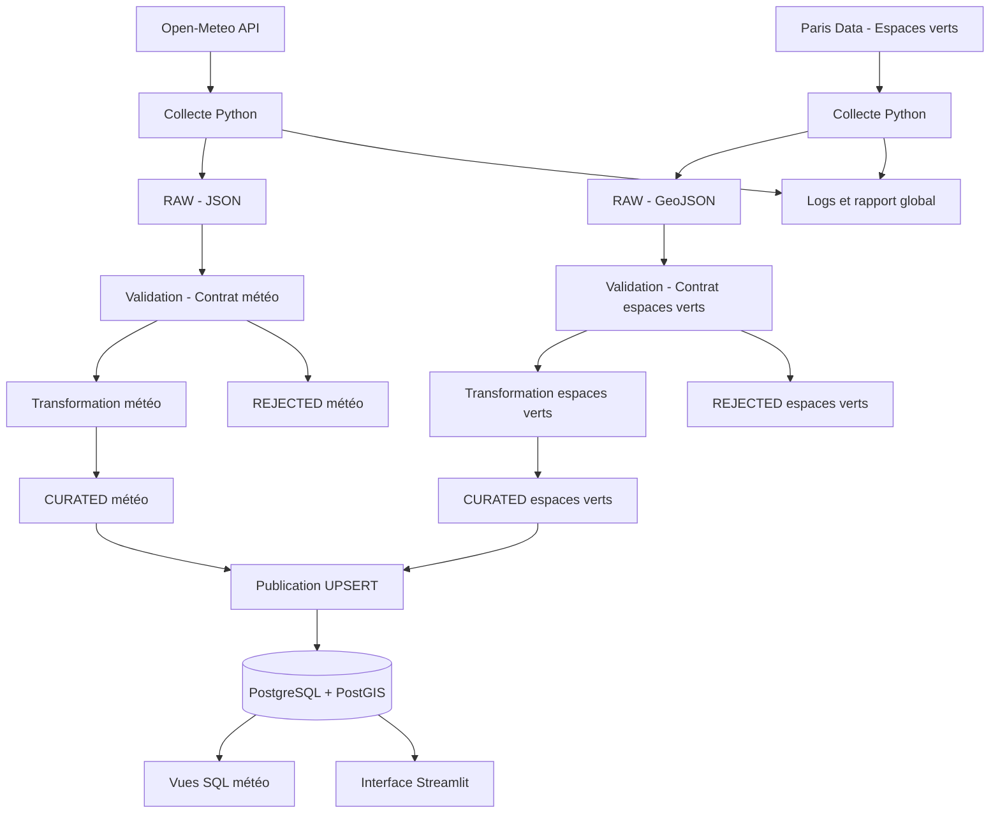

# SmartBreak — Recommandation de pauses extérieures à Paris

**Projet final — Architecture des bases de données et collecte de données — ESEO 2026–2027**

## 1. Présentation du projet

SmartBreak est un projet de collecte, de traitement et de valorisation de données destiné à préparer un service d'aide au choix de moments favorables à une pause ou à une balade en extérieur à Paris.

La qualité d'une pause extérieure dépend notamment des conditions météorologiques et des caractéristiques des espaces verts disponibles.

**Question centrale :** comment collecter, contrôler, historiser et exploiter des données météorologiques et géographiques fiables afin de préparer un service d'aide au choix des moments favorables aux pauses extérieures à Paris ?

### Public cible

- Grand public résidant à Paris ou visitant la ville.
- Personnes souhaitant organiser une pause ou une balade en extérieur.

### Périmètre actuel

La version technique implémentée comprend :

- La collecte des prévisions météorologiques horaires de Paris.
- La collecte des données géographiques des espaces verts de Paris.
- La conservation des réponses brutes (RAW).
- La validation des données selon deux contrats de qualité.
- La séparation des données acceptées et rejetées.
- La transformation et la normalisation des données.
- La publication des données validées dans PostgreSQL/PostGIS.
- L'historisation des prévisions météorologiques.
- La gestion de l'unicité des espaces verts à partir de leurs identifiants sources.
- La traçabilité des exécutions par des logs et des rapports JSON.
- La visualisation des données et des indicateurs à travers une interface Streamlit.

L'interface Streamlit permet notamment de consulter les indicateurs du pipeline, les prévisions météorologiques et la répartition des espaces verts.

Le moteur de recommandation intelligent, le score de confort extérieur et la personnalisation des suggestions ne sont pas encore implémentés.

## 2. Sources de données

Deux sources complémentaires sont intégrées.

### 2.1. Prévisions météorologiques — Open-Meteo

**Source :** Open-Meteo Forecast API

URL : https://api.open-meteo.com/v1/forecast

- Localisation : Paris, France.
- Coordonnées demandées : latitude 48.8566, longitude 2.3522.
- Format : JSON.
- Fréquence : horaire.
- Horizon de collecte : 7 jours.

Variables collectées :

| Variable | Description | Unité |
|---|---|---|
| `temperature_2m` | Température à 2 mètres | °C |
| `apparent_temperature` | Température ressentie | °C |
| `relative_humidity_2m` | Humidité relative | % |
| `precipitation` | Précipitations prévues | mm |
| `precipitation_probability` | Probabilité de précipitations | % |
| `wind_speed_10m` | Vitesse du vent à 10 mètres | km/h |
| `cloud_cover` | Couverture nuageuse | % |
| `weather_code` | Code météorologique WMO | Code |

Ces données correspondent à des prévisions et non à des mesures météorologiques réellement observées.

### 2.2. Espaces verts — Paris Data

**Source :** Ville de Paris — dataset « Espaces verts et assimilés ».

Page du dataset : https://opendata.paris.fr/explore/dataset/espaces_verts/

Endpoint de collecte :

https://opendata.paris.fr/api/explore/v2.1/catalog/datasets/espaces_verts/exports/geojson

- Producteur : Ville de Paris, DEVE.
- Format : GeoJSON.
- Identifiant du dataset : `espaces_verts`.
- Identifiant métier des enregistrements : identifiant source de chaque espace vert.
- Licence : Open Database License (ODbL).
- Fréquence de mise à jour annoncée : quotidienne.

Les données comprennent des informations descriptives, des caractéristiques des espaces verts et leurs géométries géographiques.

**Attention :** le dataset contient différentes catégories d'espaces végétalisés et assimilés. Tous les enregistrements ne correspondent pas nécessairement à des parcs publics accessibles au public. Une vérification des catégories et des conditions d'accès sera nécessaire avant toute recommandation.

Les informations détaillées relatives aux sources, aux licences et aux risques techniques sont disponibles dans `docs/sources.md`.

## 3. Architecture et flux de données

Le projet repose sur un pipeline automatisé commun aux deux sources.



### Étapes du pipeline

1. **Initialisation :** connexion à PostgreSQL/PostGIS et initialisation du schéma et des vues SQL.
2. **Collecte :** récupération des données auprès des deux API.
3. **RAW :** conservation des réponses brutes avec leurs métadonnées.
4. **Validation :** application des contrats de qualité respectifs.
5. **REJECTED :** conservation des enregistrements non conformes et de leurs motifs.
6. **Transformation :** normalisation et préparation des données acceptées.
7. **CURATED :** sauvegarde des données transformées.
8. **Publication :** insertion ou mise à jour des données dans PostgreSQL/PostGIS.
9. **Traçabilité :** enregistrement des logs et génération du rapport global.
10. **Visualisation :** consultation des données publiées à travers Streamlit.

### Technologies

| Élément | Technologie |
|---|---|
| Langage | Python |
| API météo | Open-Meteo Forecast API |
| Source géographique | Paris Data |
| Formats RAW | JSON et GeoJSON |
| Contrats de données | YAML |
| Base de données | PostgreSQL |
| Données géographiques | PostGIS |
| Accès base de données | psycopg 3 |
| Tests | pytest |
| Configuration | python-dotenv |
| Interface de visualisation | Streamlit |

## 4. Installation et configuration

### Prérequis

- Python 3.10 ou version compatible avec les dépendances.
- PostgreSQL installé et démarré.
- Extension PostGIS disponible.
- Git.

### Récupération du projet

```powershell
git clone https://github.com/Abirdaboussi/SmartBreak.git
cd SmartBreak
```

### Création de l'environnement Python

```powershell
python -m venv .venv
.\.venv\Scripts\Activate.ps1
python -m pip install --upgrade pip
pip install -r requirements.txt
```

### Configuration PostgreSQL

Créer une base PostgreSQL nommée `smartbreak` et un utilisateur disposant des droits nécessaires.

Copier le fichier d'exemple :

```powershell
Copy-Item .env.example .env
```

Configurer ensuite les paramètres de connexion dans `.env` :

```dotenv
POSTGRES_HOST=localhost
POSTGRES_PORT=5432
POSTGRES_DB=smartbreak
POSTGRES_USER=smartbreak
POSTGRES_PASSWORD=VOTRE_MOT_DE_PASSE
```

Le fichier `.env` contient des informations sensibles et ne doit jamais être ajouté au dépôt Git.

L'extension PostGIS est activée par le script `sql/schema.sql`. L'utilisateur PostgreSQL doit disposer des permissions nécessaires pour créer cette extension, ou celle-ci doit être activée préalablement par un administrateur.

## 5. Exécution du pipeline

Depuis la racine du projet, avec l'environnement virtuel activé :

```powershell
python -m src.pipeline
```

Le pipeline exécute successivement la collecte, la validation, la transformation, la persistance et la publication des deux datasets.

### Lancement de l'interface Streamlit

Après avoir configuré PostgreSQL et exécuté le pipeline au moins une fois :

```powershell
python -m streamlit run app/streamlit_app.py
```

L'application est accessible à l'adresse :

http://localhost:8501

L'interface permet de consulter les indicateurs disponibles dans PostgreSQL/PostGIS. Elle ne déclenche pas automatiquement de nouvelle collecte.

### Organisation des sorties

```text
data/
├── raw/
│   ├── weather/
│   └── green_spaces/
├── curated/
│   ├── weather/
│   └── green_spaces/
└── rejected/
    ├── weather/
    └── green_spaces/

config/
└── contracts/
    ├── weather.yaml
    └── green_spaces.yaml

sql/
├── schema.sql
└── views.sql

reports/
├── run_report.json
├── weather/
└── green_spaces/

logs/
└── pipeline.log
```

Les fichiers RAW conservent les données originales. Les fichiers CURATED contiennent les données validées et transformées. Les fichiers REJECTED conservent les enregistrements non conformes et leurs motifs de rejet.

Le rapport global de la dernière exécution est disponible dans `reports/run_report.json`.

## 6. Qualité des données et tests

Chaque source dispose de son propre contrat de données.

### 6.1. Contrat météo

Fichier : `config/contracts/weather.yaml`

Huit règles sont appliquées :

| Règle | Contrôle |
|---|---|
| Q01 | Présence des champs obligatoires |
| Q02 | Unicité des timestamps |
| Q03 | Format des timestamps |
| Q04 | Ordre chronologique |
| Q05 | Fréquence horaire |
| Q06 | Types et plages numériques |
| Q07 | Validité des codes météorologiques WMO |
| Q08 | Cohérence des unités |

### 6.2. Contrat des espaces verts

Fichier : `config/contracts/green_spaces.yaml`

Sept règles sont appliquées :

| Règle | Contrôle |
|---|---|
| GQ01 | Présence et validité de l'identifiant source |
| GQ02 | Unicité de l'identifiant source |
| GQ03 | Présence du nom |
| GQ04 | Type de géométrie accepté (Polygon ou MultiPolygon) |
| GQ05 | Validité des coordonnées géographiques |
| GQ06 | Structure et fermeture des anneaux polygonaux |
| GQ07 | Valeurs numériques non négatives pour les surfaces et périmètres |

La validation géométrique topologique complémentaire est réalisée au niveau de PostGIS avec `ST_IsValid`.

### 6.3. Résultats de validation

Lors de l'exécution du 7 novembre 2026 :

| Indicateur | Météo | Espaces verts |
|---|---:|---:|
| Enregistrements collectés | 168 | 2 535 |
| Enregistrements acceptés | 168 | 2 525 |
| Enregistrements rejetés | 0 | 10 |
| Taux d'acceptation | 100 % | 99,61 % |

Pour les espaces verts, les rejets correspondent à 9 identifiants absents et 1 géométrie absente.

Ces chiffres correspondent à une exécution donnée et peuvent varier selon les prochaines collectes et les évolutions des sources.

### 6.4. Tests automatisés

Pour lancer les tests :

```powershell
python -m pytest -q
```

La suite de tests exécutée contient actuellement **19 tests réussis**.

### 6.5. Indicateurs de performance (KPI)

Les KPI de SmartBreak sont répartis en deux catégories : les indicateurs techniques mesurés sur le pipeline actuel et les indicateurs fonctionnels prévus pour la future version du service.

#### A. KPI techniques — version actuelle

Les résultats suivants ont été obtenus lors des vérifications du 7 novembre 2026.

| Indicateur | Résultat mesuré | Objectif |
|---|---:|---:|
| Taux d'acceptation des données météo | 100 % (168/168) | ≥ 95 % |
| Taux d'acceptation des espaces verts | 99,61 % (2 525/2 535) | ≥ 95 % |
| Géométries invalides en base | 0 | 0 |
| Identifiants source dupliqués | 0 | 0 |
| Tests automatisés réussis | 19/19 | 100 % |
| Durée d'exécution du pipeline intégré | 4,773 secondes | À surveiller |

Ces indicateurs permettent d'évaluer la qualité des données collectées, la cohérence du stockage et la fiabilité technique du pipeline. La durée d'exécution est une mesure ponctuelle réalisée dans l'environnement local du projet.

#### B. KPI fonctionnels — version cible

Les indicateurs suivants seront évalués après l'implémentation du moteur de recommandation intelligent. L'interface Streamlit actuelle assure uniquement la visualisation des données et ne calcule pas encore ces recommandations.

| Indicateur | Objectif cible |
|---|---:|
| Recommandations respectant les seuils météorologiques définis | ≥ 90 % |
| Recommandations associées à un espace vert identifié | 100 % |
| Pertinence des recommandations selon les utilisateurs | ≥ 80 % |
| Temps de réponse du moteur de recommandation | ≤ 3 secondes |
| Satisfaction moyenne des utilisateurs | ≥ 4/5 |

Ces objectifs permettront d'évaluer la pertinence du service, sa rapidité et son utilité pour les personnes souhaitant organiser une pause extérieure à Paris. Ils ne constituent pas des résultats mesurés dans la version actuelle.

## 7. Base de données PostgreSQL/PostGIS

Le schéma relationnel et spatial est défini dans `sql/schema.sql`.

### 7.1. Table `weather_forecasts`

Cette table conserve les prévisions météorologiques, leurs variables, leurs métadonnées et la géométrie du point de prévision au format PostGIS.

La contrainte d'unicité sur `(location, forecast_time, retrieved_at)` permet de conserver plusieurs snapshots d'une même prévision tout en évitant les doublons lors de la republication d'une même collecte.

### 7.2. Table `green_spaces`

Cette table conserve les espaces verts validés et leurs informations géographiques.

Elle comprend notamment :

- `source_id` : identifiant de l'enregistrement dans la source Paris Data.
- `name` : nom de l'espace vert.
- `type_ev` et `category` : type et catégorie.
- `postal_code` : code postal.
- `real_surface_m2` et autres surfaces disponibles.
- `perimeter_m` : périmètre.
- `geom` : géométrie Polygon ou MultiPolygon en SRID 4326.
- `representative_point` : point représentatif géographique.
- `source`, `source_url` et `retrieved_at` : métadonnées de provenance.
- `raw_properties` : propriétés originales conservées au format JSONB.

Une contrainte d'unicité sur `source_id` permet de mettre à jour les enregistrements sans créer de doublons lors des nouvelles collectes.

Des index spatiaux GiST facilitent les futures requêtes géographiques.

### 7.3. Vues SQL

Deux vues sont actuellement disponibles pour les prévisions météorologiques :

- `vw_weather_latest_forecasts` : dernière version disponible de chaque prévision horaire.
- `vw_weather_daily_summary` : synthèse journalière des températures, précipitations, probabilités de pluie, vent et couverture nuageuse.

Les agrégations journalières utilisent le fuseau `Europe/Paris`.

## 8. Traçabilité et reprise

Chaque exécution produit des fichiers associés à un identifiant de collecte et un rapport global.

Le rapport `reports/run_report.json` comprend notamment :

- Le statut global.
- La durée d'exécution.
- Le statut de chaque étape.
- Le nombre d'enregistrements collectés.
- Le nombre d'enregistrements acceptés et rejetés.
- Le taux d'acceptation.
- Les violations par règle de qualité.
- Le nombre de lignes publiées.
- Les chemins des fichiers générés.

### Stratégie de reprise

En cas d'échec :

1. Consulter `logs/pipeline.log` et `reports/run_report.json`.
2. Identifier l'étape en erreur.
3. Vérifier la disponibilité des API et de PostgreSQL.
4. Corriger la configuration ou le problème identifié.
5. Relancer le pipeline.

La publication utilise des opérations UPSERT afin de limiter les doublons lors des reprises.

Une nouvelle collecte météo crée volontairement un nouveau snapshot, tandis que les espaces verts sont actualisés à partir de leur identifiant source.

## 9. Gouvernance et organisation du dépôt

Les documents suivants complètent la documentation technique :

- `docs/data_dictionary.md` : dictionnaire des données.
- `docs/ADR_001.md` : décisions d'architecture.
- `docs/fiche_projet.md` : fiche de présentation du projet.
- `docs/gouvernance.md` : règles de gouvernance.
- `docs/sources.md` : fiches descriptives des sources.
- `docs/incident_recovery.md` : stratégie de gestion et de reprise après incident.
- `docs/architecture/architecture.md` : architecture et lineage.

Les fichiers `.env`, les environnements virtuels, les secrets et les fichiers temporaires ne doivent pas être versionnés.

Les durées de rétention définies dans la gouvernance constituent des objectifs et ne correspondent pas à une suppression automatique actuellement implémentée.

## 10. Limites et perspectives

SmartBreak constitue une première brique technique de collecte, de contrôle et de stockage de données.

Plusieurs limites doivent être prises en compte :

- Les prévisions météo sont associées à un point de référence à Paris et ne représentent pas le microclimat réel de chaque espace vert.
- Le dataset géographique contient des catégories variées qui nécessitent un filtrage selon l'accessibilité réelle.
- La qualité des résultats dépend de la disponibilité et de la qualité des sources externes.
- Le moteur de recommandation n'est pas encore implémenté.
- Aucune personnalisation selon les préférences des utilisateurs n'est actuellement disponible.

Évolutions envisagées :

- Filtrer les espaces verts réellement accessibles.
- Enrichir les données avec des informations complémentaires sur les équipements et les horaires d'ouverture.
- Développer des analyses spatiales avec PostGIS.
- Définir un score explicable de confort extérieur.
- Développer un moteur de recommandation de pauses et de balades.
- Enrichir l'interface Streamlit avec une carte interactive des espaces verts et des indicateurs complémentaires.
- Automatiser la collecte et le suivi de la qualité.

## 11. Utilisation d'outils d'intelligence artificielle

Des outils d'intelligence artificielle ont été utilisés comme assistance au développement, à la structuration de la documentation et à l'analyse des erreurs.

Les scripts, les résultats des tests, les requêtes SQL et le fonctionnement du pipeline ont été vérifiés dans l'environnement local du projet. Les résultats présentés correspondent aux exécutions effectivement réalisées.

## 12. Dépôt GitHub

https://github.com/Abirdaboussi/SmartBreak
