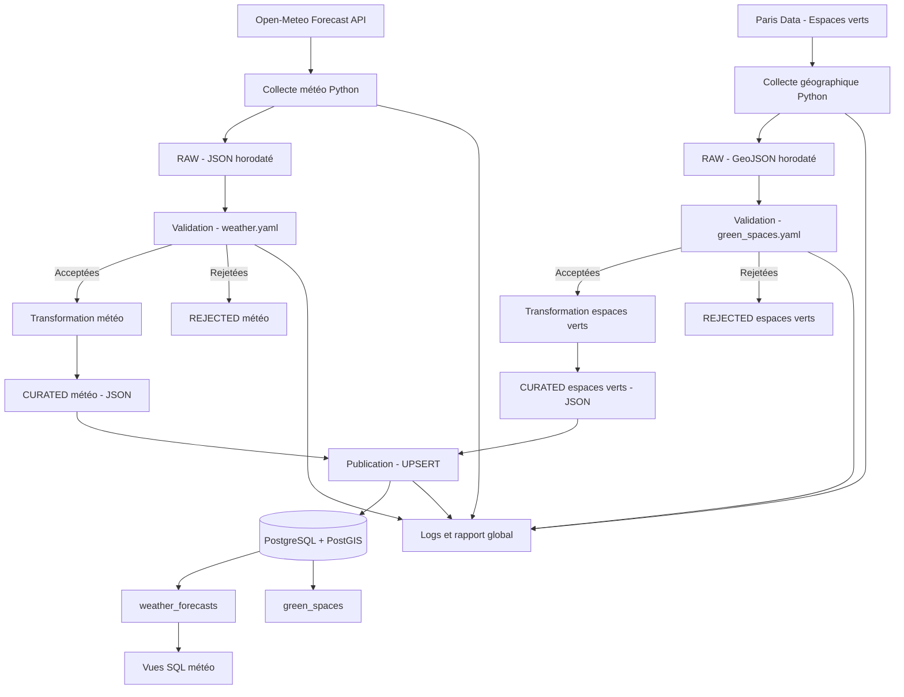
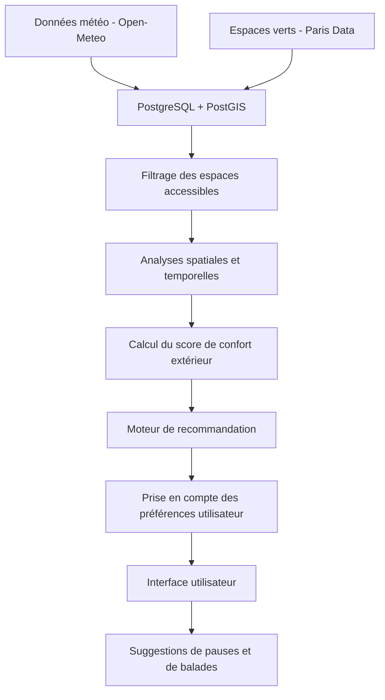
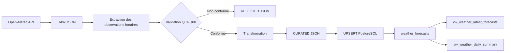
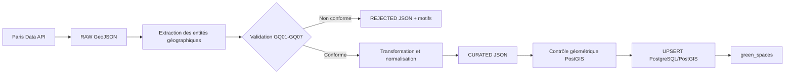

# Architecture SmartBreak

## 1. Architecture V1 — Version implémentée

La V1 de SmartBreak repose sur un pipeline automatisé multi-sources qui collecte, valide, transforme et publie deux datasets complémentaires :

- Les prévisions météorologiques horaires de Paris, provenant d'Open-Meteo.
- Les données géographiques des espaces verts de Paris, provenant de Paris Data.

Les deux flux sont traités séparément avec leurs propres contrats de qualité, puis publiés dans une base PostgreSQL/PostGIS.

### 1.1. Vue globale de l'architecture

### 1.2. Description des composants

| Composant | Responsabilité |
|---|---|
| Collecteurs Python | Récupérer les données depuis les API externes |
| Zone RAW | Conserver les réponses originales et les métadonnées de collecte |
| Contrats YAML | Définir les champs attendus et les règles de qualité |
| Validation | Identifier les enregistrements conformes et non conformes |
| Zone REJECTED | Conserver les données rejetées et leurs motifs |
| Transformation | Normaliser les données acceptées et préparer les champs destinés à la base |
| Zone CURATED | Conserver les données validées et transformées |
| Publication | Insérer ou mettre à jour les données avec des opérations UPSERT |
| PostgreSQL/PostGIS | Stocker les données relationnelles et géographiques |
| Vues SQL | Faciliter la consultation des prévisions météorologiques |
| Logs et rapports | Assurer la traçabilité des exécutions |

### 1.3. Organisation des traitements

Le pipeline est orchestré par `src/pipeline.py`.

Il exécute les opérations suivantes :

1. Initialisation de PostgreSQL/PostGIS et des vues SQL.
2. Collecte et traitement des données météorologiques.
3. Collecte et traitement des données des espaces verts.
4. Publication des deux datasets dans la base.
5. Génération du rapport global `reports/run_report.json`.

Chaque source dispose de ses propres scripts de collecte, validation, transformation et persistance.

## 2. Architecture V2 — Évolutions envisagées

La V2 représente l'évolution fonctionnelle de SmartBreak vers un véritable système de recommandation de pauses extérieures.

Elle n'est pas encore implémentée.

Les principales évolutions envisagées sont :

- Filtrer les espaces verts selon leur accessibilité réelle.
- Exploiter les géométries et les points représentatifs avec PostGIS.
- Enrichir les données avec les horaires d'ouverture et les équipements disponibles.
- Développer un score explicable de confort extérieur.
- Croiser les conditions météorologiques avec les caractéristiques des espaces verts.
- Développer un moteur de recommandation.
- Concevoir une interface permettant de consulter les suggestions.

Une attention particulière devra être portée à la résolution géographique : les prévisions météo collectées correspondent à un point de référence à Paris et ne représentent pas le microclimat de chaque espace vert.

## 3. Lineage — Traçabilité des données

Le lineage décrit le parcours des données depuis leur source jusqu'à leur stockage et leur consultation.

### 3.1. Lineage des données météorologiques

### 3.2. Lineage des espaces verts

Les géométries sont stockées dans le système de référence spatial EPSG:4326. PostGIS réalise un contrôle topologique complémentaire avec `ST_IsValid` avant la publication.

### 3.3. Métadonnées de traçabilité

| Élément | Rôle |
|---|---|
| `source` | Identifie le fournisseur des données |
| `source_url` | Identifie l'API utilisée |
| `retrieved_at` | Date et heure de collecte |
| `forecast_time` | Date et heure auxquelles les conditions météo sont prévues |
| `source_id` | Identifiant d'un espace vert dans Paris Data |
| `run_id` | Identifie une collecte et ses fichiers associés |
| `rule_violations` | Comptabilise les violations des règles de qualité |
| `logs/pipeline.log` | Trace les étapes d'exécution |
| `reports/run_report.json` | Résume le résultat global du pipeline |

### 3.4. Gestion temporelle

Pour les prévisions météorologiques, deux dates doivent être distinguées :

- `retrieved_at` : moment où les prévisions ont été collectées.
- `forecast_time` : moment auquel les conditions météorologiques sont prévues.

Cette distinction permet de conserver plusieurs snapshots d'une même prévision et de suivre son évolution au fil des collectes.

Pour les espaces verts, `retrieved_at` indique le moment de récupération des informations depuis Paris Data. L'identifiant `source_id` permet de retrouver et de mettre à jour le même espace vert lors des collectes suivantes.

## 4. Stockage PostgreSQL/PostGIS

La base de données centralise les deux datasets dans des tables distinctes.

| Table | Contenu | Particularité |
|---|---|---|
| `weather_forecasts` | Prévisions météorologiques horaires | Historisation par localisation, heure de prévision et instant de collecte |
| `green_spaces` | Espaces verts et géométries associées | Unicité de l'identifiant source et indexation spatiale |

Des index spatiaux GiST sont définis pour faciliter les futures requêtes géographiques.

Les vues SQL actuellement implémentées concernent les données météorologiques :

- `vw_weather_latest_forecasts`
- `vw_weather_daily_summary`

Les analyses spatiales avancées et les vues combinant les deux datasets constituent des évolutions possibles.

## 5. Limites de l'architecture actuelle

La V1 assure la collecte, la validation, la transformation et le stockage des deux sources. Elle ne constitue pas encore un moteur complet de recommandation.

Les principales limites sont :

- Les données météo sont associées à un point de référence unique à Paris.
- Les catégories du dataset des espaces verts ne garantissent pas systématiquement l'accès au public.
- Les horaires d'ouverture et les conditions d'accessibilité ne sont pas encore intégrés à un moteur de décision.
- Aucun score de confort extérieur n'est actuellement calculé.
- Aucune recommandation personnalisée n'est encore générée.

Ces limites définissent les principales orientations de la V2.