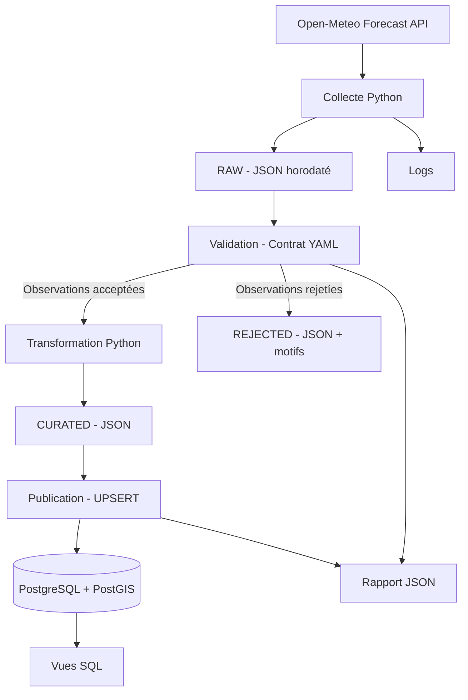
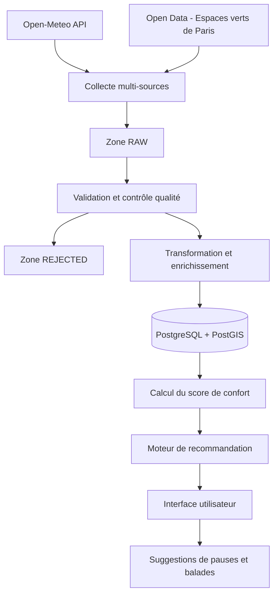
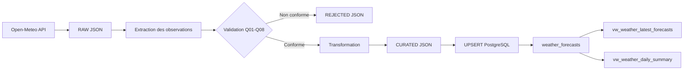

# Architecture SmartBreak

## 1. Architecture V1 — Version implémentée

Cette architecture représente le pipeline météo actuellement développé et testé.

## 2. Architecture V2 — Architecture cible envisagée

Cette architecture représente les évolutions possibles. Elle n'est pas encore implémentée.

## 3. Lineage — Traçabilité des données

Le lineage décrit le chemin suivi par une observation depuis sa collecte jusqu'à sa consultation.

### Métadonnées de traçabilité

| Élément | Røle |
|---|---|
| `source` | Identifie le fournisseur |
| `source_url` | Identifie l'API utilisée |
| `retrieved_at` | Date et heure de collecte |
| `forecast_time` | Date et heure de la prévision |
| `run_id` | Identifie la collecte et ses fichiers associés |
| `rule_violations` | Compte les violations des rèples de qualité |
| `logs/pipeline.log` | Trace les étapes d'exécution |
| `reports/run_report.json` | Résume le résultat du pipeline |

### Gestion temporelle

Deux dates doivent être distinguées :

- `retrieved_at` : moment où les prévisions ont été collectées.
- `forecast_time` : moment auquel les conditions météorologiques sont prévues.

Cette distinction permet de conserver plusieurs versions d'une même prévision lorsque plusieurs collectes sont effectuées.
